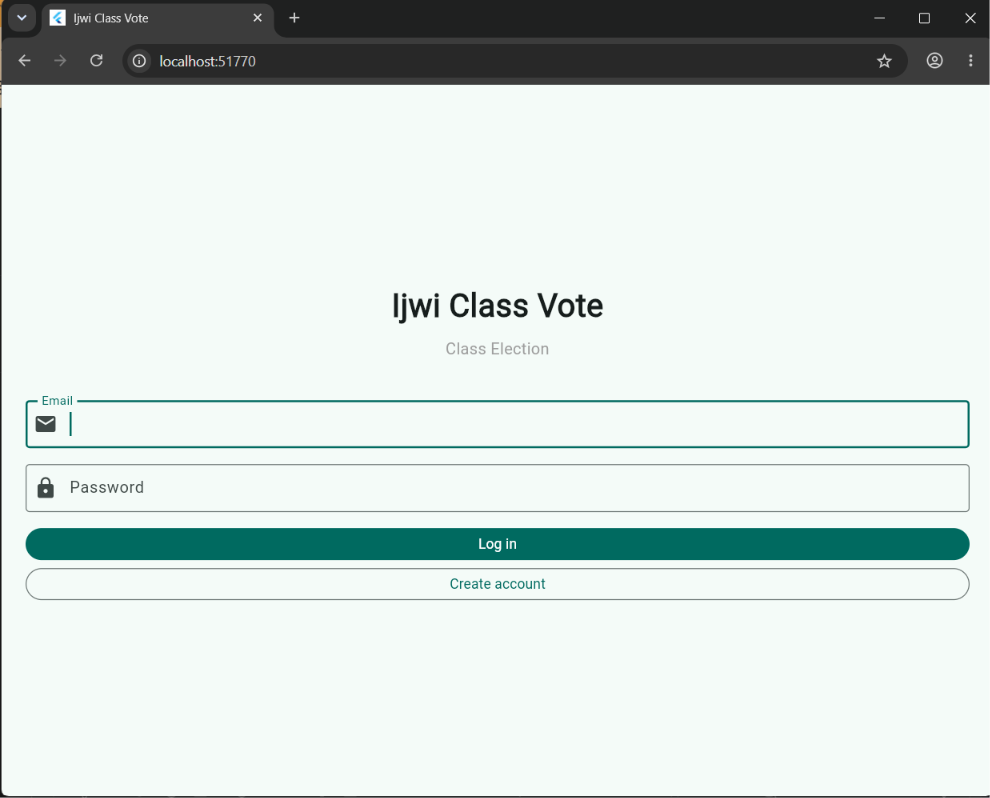
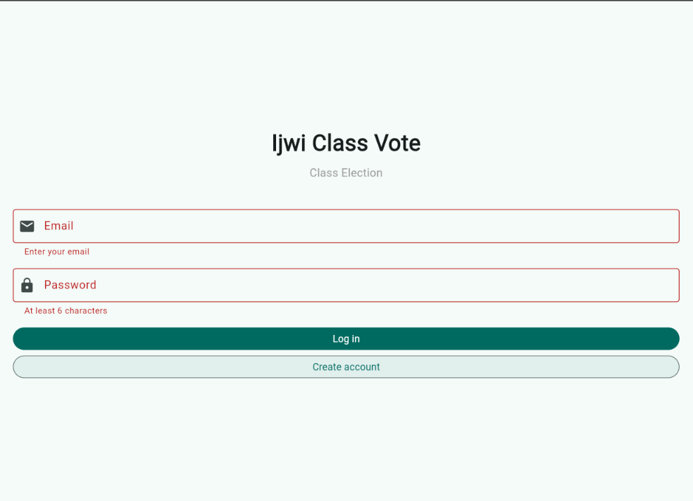
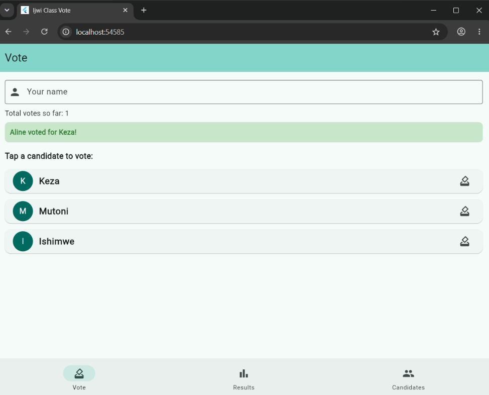
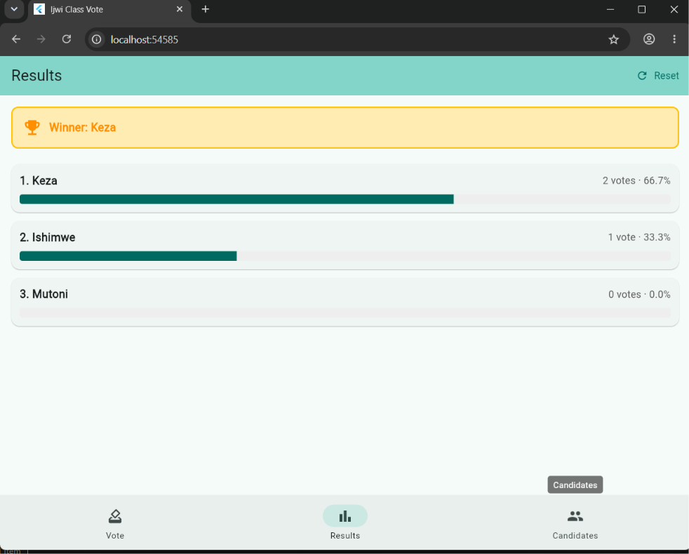
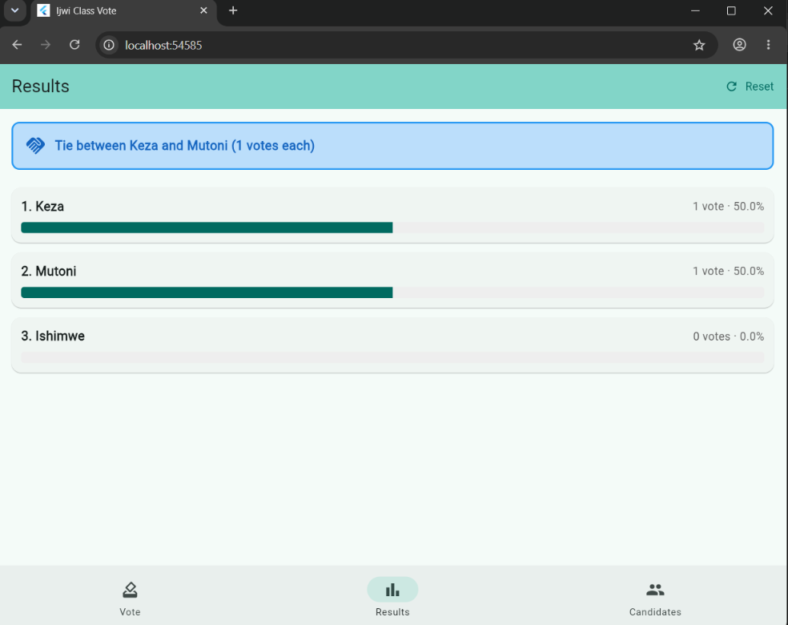
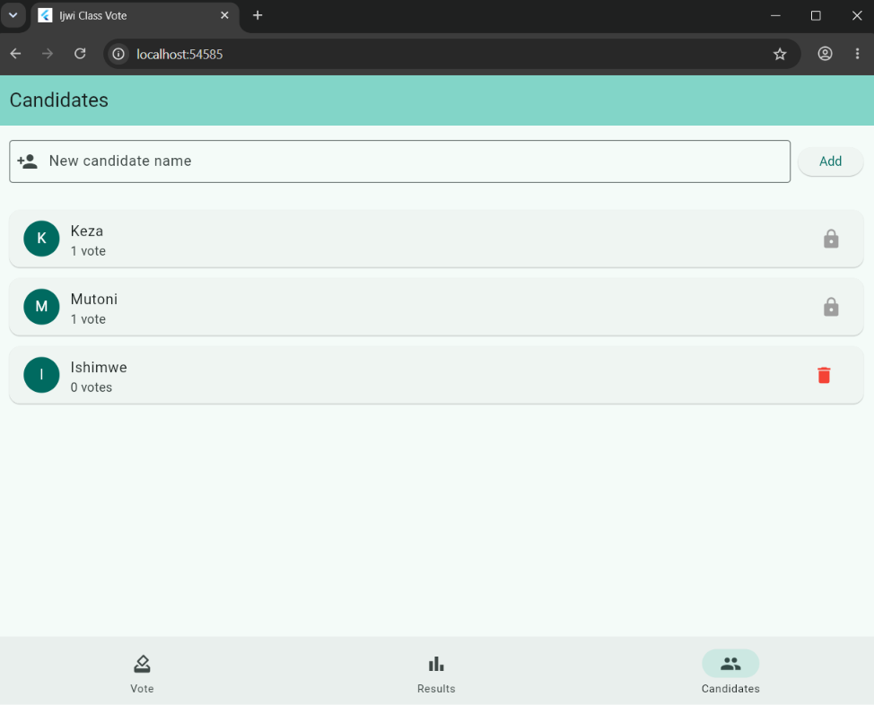

# Ijwi Class Vote

**Student:** Immaculate MUTARUTWA  
**ID:** 27806  
**Group:** A  
**Course:** Mobile Programming — Week 3, Session 6

A class election app that signs users in with Firebase Authentication, and each user's data is saved in Cloud Firestore under their own id, so two accounts never see each other's data, and every change appears live.

## Screenshots

